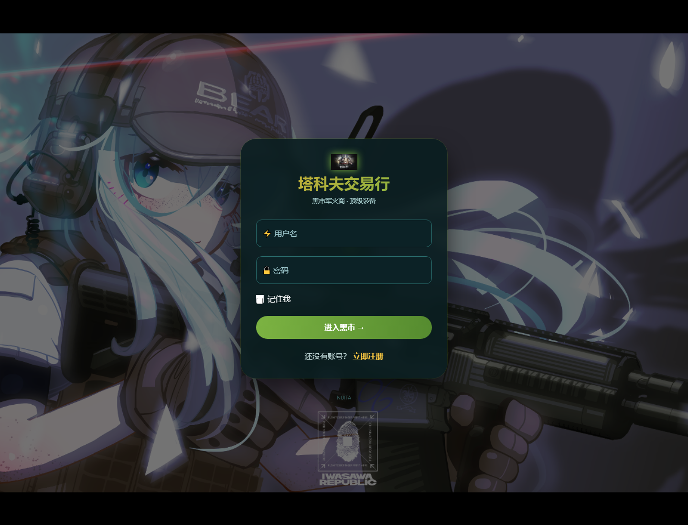

# 三角洲交易行 · DeltaTradeHub

面向《三角洲行动》的虚拟物品交易平台。ASP.NET WebForms 实现，包含前台交易站与后台管理系统。



## 技术栈

- ASP.NET WebForms / C#（.NET Framework 4.7.2）
- Entity Framework 6（Database First，`Models/Model1.edmx`）
- SQL Server LocalDB（默认，Visual Studio 自带；也可换成完整 SQL Server）
- Bootstrap 5 + jQuery + Font Awesome + ECharts
- Newtonsoft.Json
- DeepSeek API（站内 AI 助手）

## 功能

**前台**
- 注册 / 登录（密码 SHA256 存储），登录态基于 Session
- 市场行情：热门物品、最新上架、求购列表，均带分页
- 物品详情、按分类浏览（突击步枪 / 手枪 / 装备 / 医疗品 / 配件 / 近战武器）
- 出售挂单（MyListings）、我的库存（Storehouse）、购买订单（BuyOrders）
- 用户中心（UserCenter）、充值（Bank）
- 资讯：新闻列表 / 详情 / 投稿（News、NewsDetail、PostArticle）
- AI 助手（AIAssistant）：调用 DeepSeek，带预设角色与站内问答

**后台**（Admin*.aspx）
- 数据仪表盘、用户管理、物品管理、订单管理
- 充值审核、资讯管理、系统设置（站点配置、改密）

规模：24 个页面，76 个 C# 文件，约 7400 行 C# 代码。

## 数据库：首次启动自动建库

项目默认使用 **LocalDB**，不需要另外安装 SQL Server，也不需要准备账号密码：

1. 按后面「本地运行」启动站点；
2. 站点首次启动时，`Global.asax.cs` 会调用 `App_Start/DatabaseInitializer.cs`：
   - 连接 `(localdb)\MSSQLLocalDB`，数据库 `DeltaTradeHubDB` 不存在时自动创建；
   - 数据库为空库时执行 `App_Data/InitDatabase.sql`，建好全部表并写入演示数据（分类、物品、演示用户、资讯、系统设置等）。
3. 初始化结果会追加写入 `App_Data/DatabaseInit.log`；初始化失败不会阻断站点启动，可以看日志排查。
4. 想关闭自动初始化：把 `Web.config` 的 `appSettings:DatabaseAutoInit` 改成 `false`。

**改用本机完整 SQL Server**：把 `Web.config` 中 `DeltaTradeHubDBEntities` 连接串里的
`data source=(localdb)\MSSQLLocalDB` 改成 `.` 或实例名（如 `.\SQLEXPRESS`），
并确保运行站点的 Windows 账号有建库权限即可。连接串里不要提交真实的账号密码。

数据库表：

| 表 | 说明 |
| --- | --- |
| `Users` | 用户（余额、注册/登录时间、是否启用） |
| `Categories` / `Items` | 分类与物品（价格、库存、磨损度、图片） |
| `Inventory` / `Cart` | 库存、购物车 |
| `Transactions` | 交易记录 |
| `BuyOrders` / `Listings` | 求购单、挂售单 |
| `News` | 资讯文章 |
| `RechargeOrders` | 充值申请（管理员审核） |
| `SystemSettings` | 站点设置（平台名、客服邮箱、手续费率、后台提示） |
| `cs2_items` | CS2 饰品行情数据（预留） |

`sysdiagrams` 是 SSMS 生成 E-R 图时的系统表，代码未使用，初始化脚本不创建。

## 目录结构

```
deltatata/
├─ deltatata/                 # 网站项目
│  ├─ App_Start/              # 路由、Bundle、DatabaseInitializer（自动建库）
│  ├─ App_Data/
│  │  └─ InitDatabase.sql     # 建表 + 演示数据脚本
│  ├─ Models/                 # EF6 Database First 模型
│  ├─ Scripts/ Content/ img/  # 前端资源与图片
│  └─ *.aspx                  # 前台页面与 Admin* 后台页面
├─ deltatata.slnx             # Visual Studio 解决方案
└─ .gitignore
```

## 本地运行

1. 用 Visual Studio 2022 打开 `deltatata.slnx`（需要安装「ASP.NET 和 Web 开发」工作负载）
2. 还原 NuGet 包（`packages/` 未提交，VS 会自动还原）
3. 直接 F5 启动：首次启动会自动建库并初始化数据（见上一节），随后用浏览器访问
4. 想用完整 SQL Server 时，按上一节修改 `Web.config` 连接串
5. （可选）在 `Web.config` 的 `appSettings` 里填入自己的 `DeepSeekApiKey`，AI 助手才有真实回答；不填时走本地兜底回答
6. AI 助手使用的 API 地址为 `https://api.deepseek.com/v1/chat/completions`，需要能访问外网

默认账号：

- 管理员：`admin1 / 123456`（首次打开登录页时由 `Auth.aspx.cs` 自动创建，登录后进入后台）
- 普通用户：`DeltaOperator / 123456`、`SniperWolf / 123456`、`MedicRush / 123456`（初始化脚本写入）

正式使用前请立即修改默认密码。

## 说明

- 原源码中硬编码的 DeepSeek API Key 已移除，改为从 `Web.config` 的 `appSettings:DeepSeekApiKey` 读取。
- 仓库中的 `img/payment-placeholder.png` 是充值页的收款码占位图，实际部署时请替换成自己的收款码图片。
- 数据库文件（`.mdf` / `.ldf`）与 NuGet `packages/` 未纳入版本控制，用初始化脚本和包还原即可重建。
- 物品图片位于 `img/items/`，资讯图片位于 `img/`，均可按 `ImageUrl` 字段自行替换。
